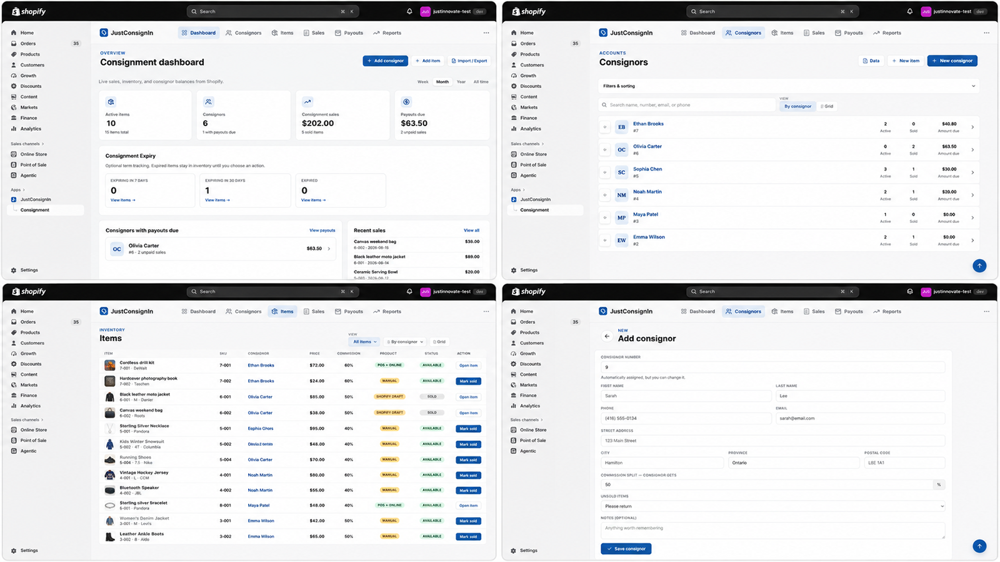
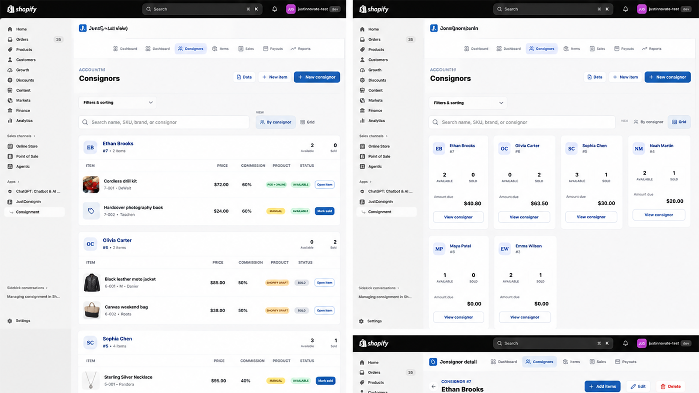
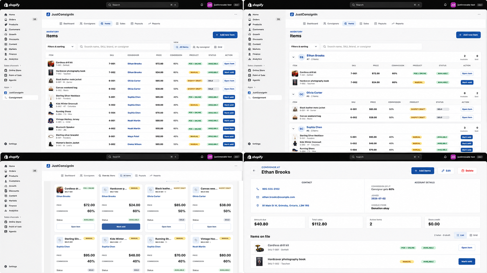
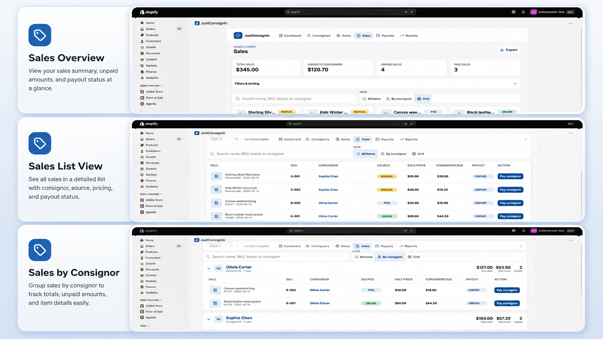
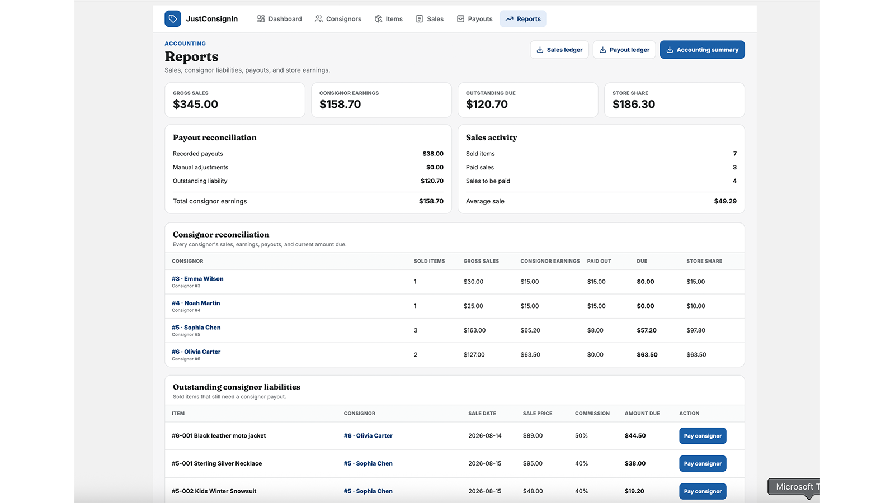

# JustConsignIn: Shopify Consignment App

**JustConsignIn** is a Shopify app for consignment stores. It runs the whole consignment workflow inside Shopify: sign up consignors, take in their items from a phone, turn items into Shopify products, sell them online or at the counter with Shopify POS, and pay each consignor their share.

- **Website:** https://www.justconsignin.com
- **App URL:** https://app.justconsignin.com
- **Test copy of this app:** [JustConsignin-Shopify-TESTING](https://github.com/Justindema76/JustConsignin-Shopify-TESTING)

> This is the **live** app that merchants use. Big changes are built and tested in the TESTING repo first, then brought over here. Small fixes go straight here.

---

## The problem it solves

Consignment stores sell items that belong to other people. Each sale has to be traced back to the right consignor, the commission split, and the consignor paid. Most stores track this in spreadsheets or separate software that doesn't talk to Shopify, so items get re-typed, sales are missed, and payouts are wrong.

JustConsignIn keeps consignors, items, sales and payouts **inside Shopify**, connected to the real products and orders.

## Features

### Consignors
- Consignor profiles: contact details, address (country and province dropdowns), commission %, what to do with unsold items, and notes
- Each consignor's dashboard shows their items, sales, what they've been paid to date, and payout history
- Each consignor belongs to a **store location** (multi-location support)

### Item intake (built for phones)
- Fast mobile intake: choose the consignor, then add the description, price, category, brand, size, condition and photos
- Each item gets an **item number**, which is editable. Changing it updates the SKU and the Shopify variant.
- **Barcode labels:** print a label with the item number and barcode directly from the item page (tested on 2.25 × 1.25 in thermal labels), or download a PDF

### Shopify products
- Create a real Shopify product from an item: photos, SEO title and description, SKU, weight and status (Active / Draft)
- Publish to **Shopify POS** and optionally to the online store
- New items are auto-tagged `Consignment` so they show up in a "Consignment" smart collection
- Items are stocked at the consignor's store location, and re-syncing never overwrites stock
- An "Edit in Shopify" button on linked items

### Sales
- The **`orders/paid` webhook** marks the item sold automatically when its product sells, online or on POS
- A **POS extension** (POS home tile) lets staff look up a consignment item at the counter
- Manual sales for items that aren't linked to a Shopify product

### Payouts and reports
- Create payouts per consignor from their sold, unpaid items, with the commission split worked out
- Payout receipt you can email to the consignor
- Transactions and reports screens
- **CSV import / export** of consignors and items (templates included: `consignors-and-items-import-template.csv`)

### Social posting (Growth plan)
- Connect a **Buffer** account and post an item to social media while creating it
- A Meta (Facebook / Instagram) product post composer that works with existing Shopify products

## Plans

| Plan | Price | Includes |
|---|---|---|
| **Starter** (Tier 1) | $19 / month | Manual workflow: consignors, manual items, manual sales, payouts |
| **Growth** (Tier 2) | $29 / month | Everything in Starter + Shopify products, photos, barcode labels, POS, social posting |

Both plans come with a free trial. Billing uses Shopify's App Pricing (`app/billing.server.js`, `app/routes/app.plans.jsx`).

## Screenshots

| Dashboard | Consignors | Items |
|---|---|---|
|  |  |  |

| Sales | Reports |
|---|---|
|  |  |

---

## Tech stack

- **Shopify app:** React Router 7 (Shopify's app template), embedded in the Shopify admin with App Bridge, styled to match Shopify Polaris
- **Data:** consignors and items are stored as **Shopify metaobjects** (`consignor`, `consignment_item`) linked to products. The merchant's data lives in their own store.
- **App database:** Prisma + SQLite, used only for sessions and Buffer connections
- **Extensions:** `extensions/consignment-sale`, a Shopify POS UI extension
- **Hosting:** Docker container (Node 20)

## Project structure

```text
app/
├── routes/                 Pages and API routes
│   ├── app._index.jsx      Main app (dashboard, consignors, items, sales, payouts)
│   ├── app.plans.jsx       Plan selection / billing
│   ├── app.settings.jsx    Settings (store locations, etc.)
│   ├── app.print.$itemNumber*.jsx   Barcode label print / PDF
│   ├── api.consignment*.jsx         Consignment API
│   ├── api.pos-consignment.jsx      Used by the POS extension
│   ├── api.social*.jsx, buffer.*    Social posting / Buffer OAuth
│   └── webhooks.*                   orders/paid, uninstall, GDPR compliance
├── pages/consignment/      Screens: Dashboard, Consignors, Intake, Items, Sales, Payouts, Reports, Import
├── pages/shopify/          Shopify product screens
├── components/             Shared UI (consignment + social)
├── metaobjects.server.js   Metaobject definitions and reads/writes
├── locations.server.js     Multi-location support
├── item-label.server.js    Label data
└── billing.server.js       Plans and billing
extensions/consignment-sale/   Shopify POS extension
prisma/                        Session + Buffer storage
```

## Run locally

Requires Node 20.19+ or 22.12+, the Shopify CLI, and a Shopify Partner account with a development store.

```bash
npm install
npm run dev        # shopify app dev
```

## Workflow

1. Big features and redesigns are built in **[JustConsignin-Shopify-TESTING](https://github.com/Justindema76/JustConsignin-Shopify-TESTING)** and tested on a separate test store.
2. Once approved, they're migrated here. This repo's billing, plans, `shopify.app.toml` and Docker settings are never overwritten.
3. Small, low-risk fixes go straight to this repo and are copied to TESTING so the two stay in sync.
4. A backup branch and tag are made before every large migration.

---

**Developer:** Justin DeMatteis ([justindematteis.com](https://www.justindematteis.com))
